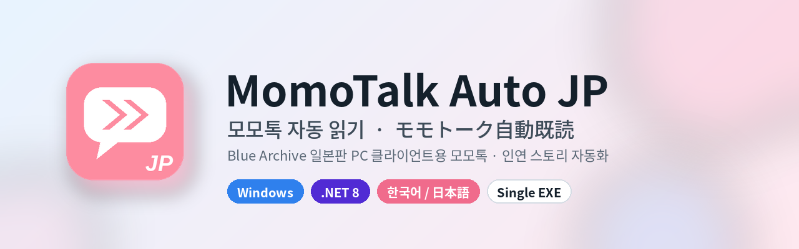

<div align="center">



[한국어](README.md) | **日本語**


ブルーアーカイブ **日本版PCクライアント**用<br>
未読のモモトークを開いて → 返信して → 絆ストーリーをスキップして → 報酬まで受け取るツール

[**ダウンロード**](../../releases/latest) · [使い方](#-クイックスタート) · [困ったとき](#-困ったとき)

</div>

<br>

## ✨ 機能

| | |
|---|---|
| 💬 **モモトーク自動処理** | 未読のトークを上から順に開き、返信の選択肢を自動で選びます |
| ⏩ **絆ストーリースキップ** | 絆カードが出たら入場 → スキップ → 確認 → 報酬画面を閉じるまで進めます |
| 🖱️ **マウス / キーボード** | ボタンをクリックするか、ショートカットキーを押すかを選べます。キーは動作ごとに設定可能 |
| 🖥️ **解像度設定** | 1280x720〜3840x2160 または手動入力。解像度を変えてもテンプレートを自動で拡大縮小します |
| 🌏 **한국어 / 日本語** | 設定ですぐ切り替え。文字サイズも3段階 |
| 🪶 **軽量** | 外部ライブラリなし、C#だけの単一実行ファイル |

<br>

## 📥 インストール

1. [Releases](../../releases/latest) から `MomotalkAutoJP-x.x.x.zip` をダウンロードして展開します。
2. `MomotalkAutoJP.exe` を実行します。
   - [.NET 8 Desktop Runtime](https://dotnet.microsoft.com/download/dotnet/8.0) がない場合はインストール案内が出ます。
   - 「WindowsによってPCが保護されました」と出たら **詳細情報 → 実行** を押してください。

<br>

## 🚀 クイックスタート

### 1. 設定

ゲームを **ウィンドウモード** で起動し、**[設定]** で

- **ゲーム解像度** — ゲームで選んだ解像度と同じに (または `今のゲーム画面サイズを入力`)
- **入力方式** — マウスクリック / キーボードショートカット
- **言語・文字サイズ**

### 2. テンプレートのキャプチャ (初回のみ)

このツールは画面上のボタンの絵を探して動作します。ゲーム画像は同梱していないため、**自分のゲーム画面から直接キャプチャ**します。

```
[テンプレート] → 項目を選択 → ゲームでそのボタンが見える画面にする
              → [画面を更新] → ボタンだけドラッグ → [選択範囲を保存] → [認識テスト]
```

<details>
<summary><b>キャプチャする項目 (11個)</b></summary>

| 項目 | 場所 | コツ |
|---|---|---|
| ロビーのモモトークアイコン | ロビー(メイン画面) | 数字バッジは含めずアイコンの絵だけ |
| モモトークのトークタブ | モモトーク左側の縦タブ | 吹き出しのタブ |
| 未読バッジ | トーク一覧の右側 | オレンジの丸ひとつだけをぴったり |
| 返信の見出し | トーク画面右下 | 選択肢ボタンは含めず見出しだけ |
| 絆ストーリーのカード | トーク画面 | 生徒名の部分を除くと認識しやすい |
| 絆ストーリー入場ボタン | カードを押した後 | 青いボタン |
| ストーリーのMENUボタン | ストーリー再生中の右上 | |
| ストーリーのスキップボタン | MENUを押した後 | キーボードモードでスキップキーを設定していれば不要 |
| 確認ボタン | スキップ確認ウィンドウ | |
| 報酬画面の目印 | ストーリー終了後 | 青輝石アイコンなど必ず見える部分 |
| モモトークの閉じるボタン *(任意)* | モモトーク右上 | なければEscで閉じます |

</details>

### 3. 実行

1. モモトークの並び順を **未読順** にしておきます。
2. ゲームを **ロビー** にして **[▶ 開始]**。
3. 終わると自動で止まります。途中で止めるには **[■ 停止]**。

> [!NOTE]
> マウスモードは実際のカーソルを動かします。実行中はマウスに触れないでください。

<br>

## ⚙️ 設定項目

| 項目 | 初期値 | 説明 |
|---|---|---|
| ゲーム解像度 | 1920 x 1080 | 認識・クリック座標の基準 |
| 入力方式 | マウス | キーボードモードの初期キー: 返信 `1`、入場・確認 `Space`、スキップ・閉じる `Esc` |
| ボタン認識の精度 | 0.88 | 見つからないときは下げ、違う所を押すときは上げる |
| 未読バッジの認識精度 | 0.80 | バッジ内の数字が変わるため少し低め |
| 画面キャプチャ方式 | ウィンドウを直接 | 真っ黒に映るときは `画面そのまま` |
| 動作の間隔 | 900 ms | PCやゲームが重いときは増やす |
| 待機の制限時間 | 40 秒 | ボタンが見つからなければ停止して原因を表示 |
| 返信選択肢までの距離 | 自動 | 返信の見出し → 最初の選択肢までの縦の距離 |

設定・テンプレート・ログは `%AppData%\MomotalkAutoJP\` に保存されます。

<br>

## ❓ 困ったとき

<details>
<summary><b>「○○が見つかりませんでした」で止まる</b></summary>

その項目を **[テンプレート]** で撮り直し、**[認識テスト]** で確認してください。それでもだめなら設定の **ボタン認識の精度** を0.02〜0.05ずつ下げてみてください。
</details>

<details>
<summary><b>違う所を押してしまう</b></summary>

ボタンをもっとぴったり撮り直すか、**ボタン認識の精度** を上げてください。
</details>

<details>
<summary><b>返信が押されない</b></summary>

マウスモード: **返信選択肢までの距離** を調整してください。<br>
キーボードモード: 設定の **返信を選ぶ** キーを確認してください。
</details>

<details>
<summary><b>テンプレート画面が真っ黒になる</b></summary>

設定 → 画面キャプチャ方式 → **画面そのまま**。この場合、ゲーム画面を他のウィンドウで隠さないでください。
</details>

<details>
<summary><b>クリックやキー入力が効かない</b></summary>

ゲームが管理者権限で動いている場合、このツールも **管理者として実行** しないと入力が届きません。
</details>

<details>
<summary><b>解像度の警告が出る</b></summary>

設定のゲーム解像度を実際のゲーム画面サイズに合わせてください。**[画面確認]** で実際のサイズが表示されます。
</details>

解決しない場合は `%AppData%\MomotalkAutoJP\log.txt` を添付して [Issue](../../issues/new/choose) を作成してください。

<br>

## 🔨 ビルド

```bash
dotnet publish MomotalkAutoJP/MomotalkAutoJP.csproj -c Release -r win-x64 \
  --self-contained false -p:PublishSingleFile=true -o publish
```

- `main` にプッシュすると GitHub Actions がビルドして **Artifacts** にアップロードします。
- `v1.0.0` のようなタグをプッシュすると **Releases** に zip が自動で公開されます。

<br>

## ⚠️ 注意事項

- 本ツールは **非公式のファンメイドツール** であり、NEXON Games・Yostar とは関係ありません。
- 画面認識とマウス/キーボード入力のみを使い、ゲームファイル・メモリ・通信には触れません。
- ただし自動入力ツールはゲームの利用規約に反する可能性があります。**ご利用は自己責任でお願いします。**
- リポジトリにはゲーム画像は含まれていません。

## 📄 ライセンス

[MIT](LICENSE)
