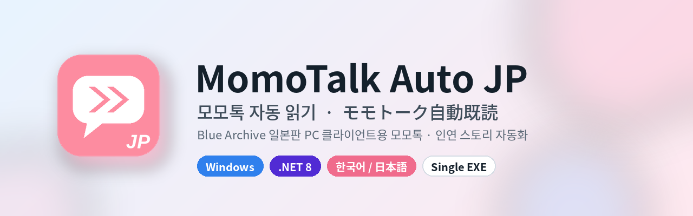

<div align="center">



**한국어** | [日本語](README.ja.md)


블루 아카이브 **일본판 PC 클라이언트**에서<br>
안 읽은 모모톡을 열고 → 답장하고 → 인연 스토리를 스킵하고 → 보상까지 받아 주는 프로그램

[**다운로드**](../../releases/latest) · [사용법](#-빠른-시작) · [문제 해결](#-문제-해결)

</div>

<br>

## ✨ 기능

| | |
|---|---|
| 💬 **모모톡 자동 처리** | 안 읽은 대화를 위에서부터 순서대로 열고 답장 선택지를 자동으로 고릅니다 |
| ⏩ **인연 스토리 스킵** | 인연 카드가 나오면 입장 → 스킵 → 확인 → 보상 화면 닫기까지 진행합니다 |
| 🖱️ **마우스 / 키보드** | 버튼을 클릭할지, 단축키를 누를지 고를 수 있습니다. 키는 동작마다 따로 지정 |
| 🖥️ **해상도 설정** | 1280x720 ~ 3840x2160 또는 직접 입력. 해상도를 바꿔도 템플릿 크기를 자동으로 맞춥니다 |
| 🌏 **한국어 / 日本語** | 설정에서 바로 전환. 글자 크기도 3단계로 조절 |
| 🪶 **가벼움** | 외부 라이브러리 없이 C#만 사용한 단일 실행 파일 |

<br>

## 📥 설치

1. [Releases](../../releases/latest)에서 `MomotalkAutoJP-x.x.x.zip`을 받아 압축을 풉니다.
2. `MomotalkAutoJP.exe`를 실행합니다.
   - [.NET 8 Desktop Runtime](https://dotnet.microsoft.com/download/dotnet/8.0)이 없으면 설치 안내가 뜹니다.
   - "Windows의 PC 보호" 창이 뜨면 **추가 정보 → 실행**을 누르세요.

<br>

## 🚀 빠른 시작

### 1. 설정

게임을 **창 모드**로 켠 뒤 **[설정]** 에서

- **게임 해상도** — 게임에서 고른 해상도와 똑같이 (또는 `지금 게임 창 크기로 채우기`)
- **입력 방식** — 마우스 클릭 / 키보드 단축키
- **언어 · 글자 크기**

### 2. 템플릿 캡처 (처음 한 번)

이 프로그램은 화면에서 버튼 그림을 찾아서 동작합니다. 게임 이미지는 포함되어 있지 않으므로 **내 게임 화면에서 직접 캡처**합니다.

```
[템플릿] → 항목 선택 → 게임에서 그 버튼이 보이는 화면 띄우기
        → [화면 새로고침] → 버튼만 드래그 → [선택 영역 저장] → [인식 테스트]
```

<details>
<summary><b>캡처할 항목 목록 (11개)</b></summary>

| 항목 | 어디서 | 팁 |
|---|---|---|
| 로비 모모톡 아이콘 | 로비(메인 화면) | 숫자 배지는 빼고 아이콘 그림만 |
| 모모톡 대화 탭 | 모모톡 왼쪽 세로 탭 | 말풍선 모양 탭 |
| 안 읽은 메시지 배지 | 대화 목록 오른쪽 | 주황색 동그라미 하나만 딱 맞게 |
| 답장 제목줄 | 대화창 오른쪽 아래 | 선택지 버튼은 빼고 제목줄만 |
| 인연 스토리 카드 | 대화창 | 학생 이름 부분은 빼면 더 잘 인식 |
| 인연 스토리 입장 버튼 | 카드를 누른 뒤 | 파란 버튼 |
| 스토리 MENU 버튼 | 스토리 재생 중 오른쪽 위 | |
| 스토리 스킵 버튼 | MENU를 누른 뒤 | 키보드 모드에서 스킵 키를 정했다면 불필요 |
| 확인 버튼 | 스킵 확인 창 | |
| 보상 화면 표시 | 스토리 종료 후 | 청휘석 아이콘 등 항상 보이는 부분 |
| 모모톡 닫기 버튼 *(선택)* | 모모톡 오른쪽 위 | 없으면 Esc로 닫음 |

</details>

### 3. 실행

1. 모모톡 정렬을 **未読(안 읽음) 순**으로 해 둡니다.
2. 게임을 **로비**에 두고 **[▶ 시작]**.
3. 끝나면 자동으로 멈춥니다. 중간에 멈추려면 **[■ 중지]**.

> [!NOTE]
> 마우스 모드는 실제 커서를 움직입니다. 실행 중에는 마우스를 건드리지 마세요.

<br>

## ⚙️ 설정 항목

| 항목 | 기본값 | 설명 |
|---|---|---|
| 게임 해상도 | 1920 x 1080 | 인식·클릭 좌표의 기준 |
| 입력 방식 | 마우스 | 키보드 모드 기본 키: 답장 `1`, 입장·확인 `Space`, 스킵·닫기 `Esc` |
| 버튼 인식 정확도 | 0.88 | 못 찾으면 낮추고, 엉뚱한 곳을 누르면 높이기 |
| 배지 인식 정확도 | 0.80 | 배지 안 숫자가 바뀌므로 조금 낮게 |
| 화면 캡처 방식 | 창 직접 캡처 | 화면이 검게 나오면 `화면 그대로` |
| 동작 간격 | 900 ms | PC나 게임이 느리면 늘리기 |
| 대기 제한 시간 | 40 초 | 버튼이 안 보이면 멈추고 원인 표시 |
| 답장 선택지 거리 | 자동 | 답장 제목줄 → 첫 선택지까지 세로 거리 |

설정·템플릿·로그는 `%AppData%\MomotalkAutoJP\` 에 저장됩니다.

<br>

## ❓ 문제 해결

<details>
<summary><b>"○○을(를) 찾지 못했습니다" 하고 멈춰요</b></summary>

그 항목을 **[템플릿]** 에서 다시 캡처하고 **[인식 테스트]** 로 확인하세요. 그래도 안 되면 설정에서 **버튼 인식 정확도**를 0.02~0.05씩 낮춰 보세요.
</details>

<details>
<summary><b>엉뚱한 곳을 눌러요</b></summary>

버튼을 더 딱 맞게 다시 캡처하거나, **버튼 인식 정확도**를 높이세요.
</details>

<details>
<summary><b>답장이 안 눌려요</b></summary>

마우스 모드: **답장 선택지 거리**를 조절하세요.<br>
키보드 모드: 설정에서 **답장 선택** 키를 확인하세요.
</details>

<details>
<summary><b>템플릿 화면이 검게 나와요</b></summary>

설정 → 화면 캡처 방식 → **화면 그대로**. 이 경우 게임 창이 다른 창에 가려지면 안 됩니다.
</details>

<details>
<summary><b>클릭이나 키 입력이 안 먹혀요</b></summary>

게임이 관리자 권한으로 실행 중이면, 이 프로그램도 **관리자 권한으로 실행**해야 입력이 전달됩니다.
</details>

<details>
<summary><b>해상도 경고가 떠요</b></summary>

설정의 게임 해상도를 실제 게임 창 크기와 맞추세요. **[창 확인]** 을 누르면 실제 크기가 표시됩니다.
</details>

문제가 계속되면 `%AppData%\MomotalkAutoJP\log.txt` 를 첨부해서 [Issue](../../issues/new/choose)를 남겨 주세요.

<br>

## 🔨 빌드

```bash
dotnet publish MomotalkAutoJP/MomotalkAutoJP.csproj -c Release -r win-x64 \
  --self-contained false -p:PublishSingleFile=true -o publish
```

- `main` 에 푸시하면 GitHub Actions가 빌드하고 **Artifacts** 로 올립니다.
- `v1.0.0` 처럼 태그를 푸시하면 **Releases** 에 zip이 자동으로 올라갑니다.

<details>
<summary><b>프로젝트 구조</b></summary>

```
MomotalkAutoJP/
├─ Core/
│  ├─ GameWindow.cs      게임 창 찾기 · 캡처 · 클릭/키 입력
│  ├─ Img.cs             BGRA 이미지 (자르기 · 크기 변경 · PNG)
│  ├─ Matcher.cs         템플릿 매칭 (2단계 정규화 상관계수)
│  ├─ Vision.cs          해상도 변환 + 매칭
│  ├─ MomotalkBot.cs     자동 처리 흐름
│  ├─ TemplateLibrary.cs 템플릿 저장/불러오기
│  ├─ Settings.cs        설정
│  ├─ Keys.cs            키보드 모드 키 목록
│  ├─ Loc.cs             한국어 / 일본어 문구
│  └─ Logger.cs          로그
└─ Views/
   ├─ MainWindow         메인 화면
   ├─ SettingsWindow     설정
   └─ TemplateWindow     템플릿 캡처
```

</details>

<br>

## ⚠️ 주의 사항

- 이 프로그램은 **비공식 팬 제작 도구**이며 NEXON Games, Yostar와 관계가 없습니다.
- 화면 인식과 마우스/키보드 입력만 사용하며, 게임 파일·메모리·통신은 건드리지 않습니다.
- 그래도 자동 입력 도구는 게임 이용약관에 어긋날 수 있습니다. **사용에 따른 책임은 사용자에게 있습니다.**
- 저장소에는 게임 이미지가 포함되어 있지 않습니다.

## 📄 라이선스

[MIT](LICENSE)
